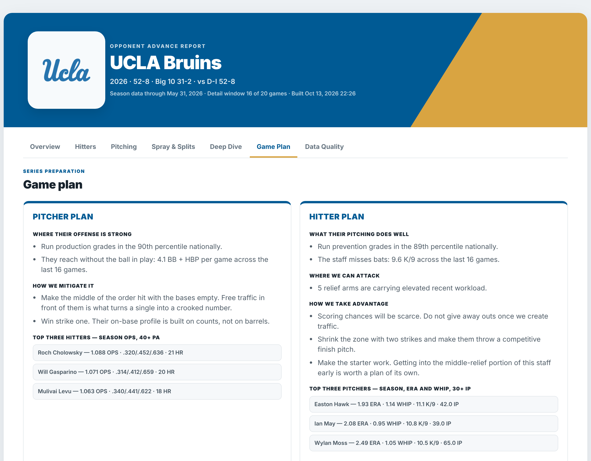
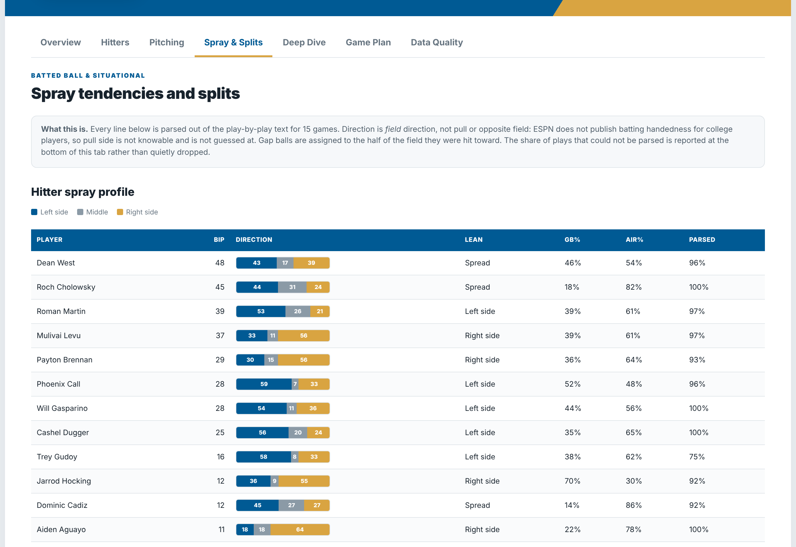
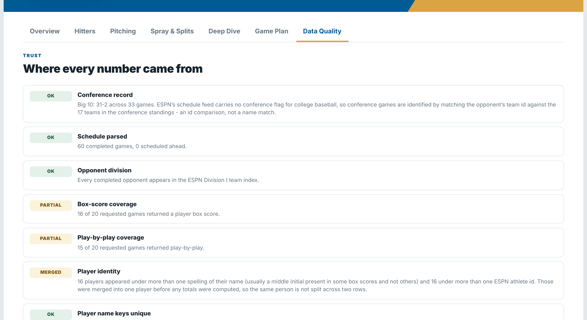

# College Pre-Series Game Plan

An automated opponent advance report for college baseball, built as a single
R Markdown file. Change the opponent's name on one line, knit, and you get a
self-contained HTML report a coaching staff can use in a pre-series meeting.

**Live example: [UCLA, 2026 season](https://rpubs.com/andrewrenteria/1455679)**



The Game Plan tab. Everything on it is derived, including the top three
hitters and pitchers, which are filtered by playing time rather than taken
off the top of a sorted list.



Spray tendencies, parsed out of play-by-play text. The parsed share is
printed per hitter so a thin sample is visible rather than implied.



The Data Quality tab, which is the one most of the work went into.

---

## The question

Before a weekend series, a staff needs to answer a short list of things. Who is
likely to start each game. Which three hitters can beat us. Where do we position
against them. Which relievers are worn down. When in the game do they score.

Most of that lives in public data. Almost none of it is in a form you can use on
a Thursday. This project builds it automatically so the prep time goes into the
plan instead of into assembling the numbers.

## What it produces

A seven-tab report:

| Tab | What a staff gets from it |
| --- | --- |
| Overview | Record, run environment, five automated flags, projected starter, series plan |
| Hitters | Expected lineup with the next most-used name in each spot, season line, recent window |
| Pitching | Rotation projection by series slot, how deep each starter goes, seven-day bullpen usage, per-pitcher splits |
| Spray & Splits | Batted-ball direction and type per hitter, RISP and leadoff splits, running game |
| Deep Dive | National percentile profile with rank, scoring by inning |
| Game Plan | Pitcher plan and hitter plan, top three of each by season and over the last five games |
| Data Quality | Where every number came from, and what could not be built |

Output is one HTML file with no external dependencies. It opens offline, works
when emailed, and prints to a clean PDF with every tab expanded.

## How it works

Three sources, divided by what each one actually does well, and never blended
inside the same column.

- **Season rate stats** come from stats.ncaa.org and are recomputed from the
  counting stats rather than read off the published rate columns.
- **Recent-game production** comes from ESPN box scores.
- **Spray, situational and baserunning tendencies** are parsed from ESPN
  play-by-play text.

The two season sources are then reconciled against each other player by player,
and disagreements are reported instead of quietly resolved. On the UCLA example
all 14 matched hitters agree within 10 points on every rate stat.

## Design decisions worth explaining

Most of the work in this project went into trusting the output, not generating
it. A few examples:

**Games that fail to download are counted and disclosed.** Every window label in
the report uses the number of games actually retrieved, not the number
requested. A report that silently renders on half its data is the main thing this
design is built against.

**Player identity is resolved once, before anything is grouped.** ESPN sends the
same player under more than one spelling across box scores, and sometimes under
more than one athlete id. Both get merged into one player up front. The UCLA
example merged 16. Left alone, those players show up twice, each row holding half
their season.

**Runs are reconstructed from the inning scoreboard, then independently
re-counted from the play text.** Both figures are published as health checks. The
first proves the scoring chart is right. The second tests the text parser that
the spray and situational tables depend on, and it touches none of the same
fields, so it cannot validate itself.

**Statistics that cannot be computed honestly are not shown.** ESPN game box
scores omit hit-by-pitch and sacrifice flies, so a recent-window OBP is not
buildable from them. The report shows a clearly labelled reach rate instead and
points to the season line for OBP.

**Conference games are identified by team id, not by name.** ESPN's college
baseball schedule feed carries no conference flag at all, so the report reads the
team's conference membership from the standings and compares ids. Matching
"Saint Mary's Gaels" to "Saint Mary's (CA)" across several hundred schools is
exactly the kind of fuzzy join that produces duplicate players.

**It is deliberately one file.** A staff member should be able to take the
`.Rmd`, change one line, press Knit, and email the result. Splitting the
helpers into a package would read as tidier on GitHub and would make the
thing harder to hand to a coach. The tests below reach into the single file
rather than the other way around.

## Tests

```r
Rscript tests/run-all.R
```

99 assertions, no test framework to install, no network. They cover the
arithmetic and parsing that the report's conclusions rest on: base-3 innings,
player identity merging, play attribution, the run ledger, conference
matching by id, and how missing values render. `tests/README.md` explains
what each file protects and why.

Most of them exist because the behaviour was wrong at some point during the
build. The ledger tests pin three properties a naive implementation fails:
the answer must not change when rows are reordered, must not change when
duplicate rows are present, and must not lose a run when a row is dropped.

## Known limitations

Stated here because a scouting product that hides its gaps is worse than one that
names them.

- Public college feeds publish no batting or throwing handedness. There are no
  platoon splits, and direction is field direction rather than pull or opposite
  field.
- Batter-level splits are reported at staff level rather than per pitcher.
  The feed does carry the pitcher on each at-bat, in rows of the form
  "X pitches to Y", so this is a gap in the current build and not in the
  data. It is the next thing to add.
- National percentiles are not adjusted for strength of schedule.
- Runner-in-scoring-position state is reconstructed from play text and is
  deliberately conservative. It undercounts before it overcounts.

## Running it

```r
# In the settings block at the top of the .Rmd:
TEAM_QUERY   <- "UCLA"     # school name or abbreviation
SEASON       <- 2026
REFRESH_DATA <- TRUE       # TRUE once for fresh data, then FALSE
```

Then knit to HTML. Use the default Knit button or Ctrl+Shift+K. The report
cannot be knit to PDF directly because it writes its own HTML and CSS. For a
PDF, knit to HTML, open the file in Chrome, and print to PDF with
"Background graphics" turned on.

Requires R 4.2 or newer, `rmarkdown`, and `baseballr` 2.0.0 or newer. The
test suite is run on R 4.3.3. Remaining packages are installed on first run.

Data pulls are cached in `cache/`, so re-knitting the same opponent is fast.
That folder is gitignored: it is large, it regenerates on demand, and it is not
mine to redistribute.

## Repository contents

```
opponent_advance_report.Rmd   the whole build, one file
tests/                        99 assertions, run with Rscript tests/run-all.R
docs/img/                     screenshots used above
README.md                     this file
LICENSE                       MIT
.gitignore                    keeps cached data and knitted output out of git
```

## Built with

R, R Markdown, baseballr, dplyr, stringr, purrr. Custom HTML and CSS with no
framework dependency.

---

Built by Andrew Renteria. Data from the ESPN college baseball API and
stats.ncaa.org.
